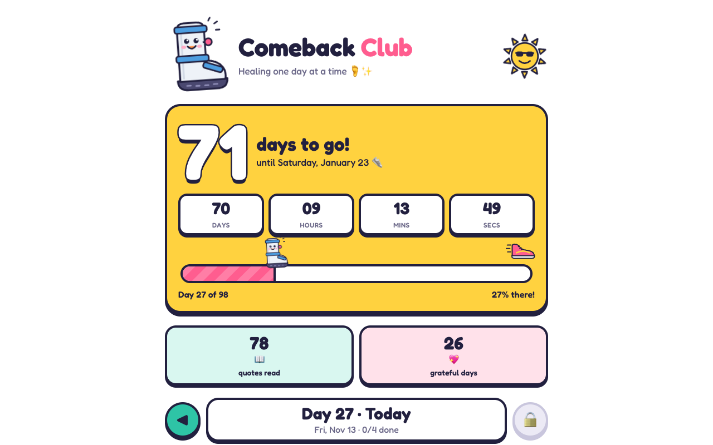

# Comeback Club

A cheerful countdown app for a recovery period: three quotes a day and an "I'm grateful" button, ticking down to the day you're back on your feet.



Live: https://motivate.akwiat.com (behind a Google-login gate)

## What it does

- Counts down (days, hours, minutes, seconds) from `START_DATE` to `GOAL_DATE`, with a progress bar.
- Each day unlocks three quotes, one from each category in `quotes.txt`: "get motivated", "it'll be ok" and
  "timeless wisdom". The order is shuffled with a fixed seed, so no quote repeats until the list runs out.
- Tap each quote to mark it read, and tap "I'm grateful" once a day. Taps are timestamped and stored per user.
- Future days stay locked; missed days can be caught up on. Days are computed in the browser's time zone.

## Run locally

```
cargo run
```

Then open http://localhost:3000. Configuration is via environment variables:

| var | default | |
|---|---|---|
| `PORT` | `3000` | listens on `127.0.0.1` |
| `DATA_DIR` | `.` | where `motivate.sqlite` is written |
| `STATIC_DIR` | `./static` | frontend files |
| `START_DATE` | `2026-10-18` | day 1 (`YYYY-MM-DD`) |
| `GOAL_DATE` | `2027-01-23` | the big day |

User identity comes from the `X-Auth-Email` header set by the auth gate in front of it; without it, everything is
stored under a single `local` user.

```
cargo test
```

A plain `cargo build` works out of the box. To build without Xcode or cross-compile for Linux with zig, copy
`.cargo/config.toml.example` to `.cargo/config.toml` (untracked). `deploy.sh` builds a static Linux (musl) binary and
ships it with radify, a small self-hosted deploy tool.

## Tech

- Rust: axum, tokio, rusqlite (bundled SQLite), tower-http for static files
- Frontend: a single `static/index.html` (vanilla JS, inline SVG art, Fredoka font)
- Quotes: `quotes.txt`, compiled into the binary
